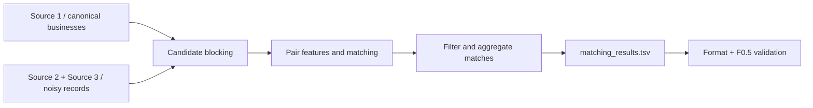

# Amazon ML Challenge — Business Entity Resolution

**Problem:** Decide which records from three independent sources refer to the same real-world business, despite inconsistent names and addresses, without shared IDs.

> This repository documents an ML competition workflow. It is not a live business registry service. Reproduction requires authorized access to the challenge data.

## See the full pipeline in one minute

### Why this is difficult

Naively comparing each business to millions of records creates too many candidate pairs. Blocking narrows comparisons **before** the matcher runs. But if blocking misses a true match, no downstream classifier can recover it. The official task therefore emphasizes recall at blocking, and precision when accepting matches. Source 1 entities may legitimately have no match.

## Explore the repository

| Start here | What it tells you |
|---|---|
| [Challenge description](task.txt) | Input sources, label conventions and submission rules |
| [Dataset inventory](00_DATASET_INVENTORY.md) | TSV parsing, row counts, country splits, field validation |
| [Data forensics](01_DATA_FORENSICS.md) | Observed name/address noise |
| [Leakage audit](03_LEAKAGE_AUDIT.md) | Potential validation contamination |
| [Experiment ledger](EXPERIMENT_LEDGER.md) | Experiment decisions and recorded outcomes |
| [Implementation directory](code/) | Source code and pipeline components |
| [Validation plan](02_VALIDATION_AND_EXPERIMENT_PLAN.md) | How to assess experiments |

## Input and output contracts

**Inputs:** Tab-separated train/test tables for Sources 1–3. The inventory specifies `entity_id`, `business_name`, `business_address`, and `country`. Training ground truth maps Source 1 entities to lists of matching Source 2/3 IDs.

**Outputs:** A `matching_results.tsv` file containing one row per Source 1 entity and its predicted matches. Challenge archive materials also require `candidate_pairs.tsv`, pipeline code and a methodology document.

**Evaluation:** Macro **F0.5**, which emphasizes precision over recall. See the original competition instructions in [task.txt](task.txt).

## Reproduction and data policy

1. Read the [data inventory](00_DATASET_INVENTORY.md) and [experiment plan](02_VALIDATION_AND_EXPERIMENT_PLAN.md).
2. Obtain the official dataset through an authorized channel. Do not fetch external business data or APIs: the provided challenge rules prohibit external lookup.
3. Inspect the code under [`code/`](code/) for the chosen blocking, training and inference entry points and its environment requirements.
4. Recreate the training/validation split according to [the leakage audit](03_LEAKAGE_AUDIT.md).
5. Generate both candidate pairs and final matches and use the competition's official validator.

**Important:** This README does not invent a universal install command; the different experiment paths must be checked against their actual source dependencies. Previous numeric results in project notes are historical experiment records, not fresh test runs from this documentation update.

## What an engineering reviewer can assess

- The tradeoff between **candidate-generation recall** and match precision.
- How entity ID strings are preserved rather than coerced to integers.
- How country-specific spelling, address and missing-value patterns affect matching.
- How leakage risks, evaluation and output format are documented.

## Provenance and collaboration

This is a competition/research codebase. Consult original commits and submission artifacts for contributor-level attribution; repository ownership alone does not prove sole authorship.
